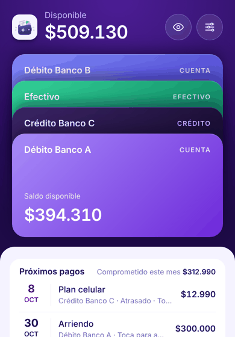
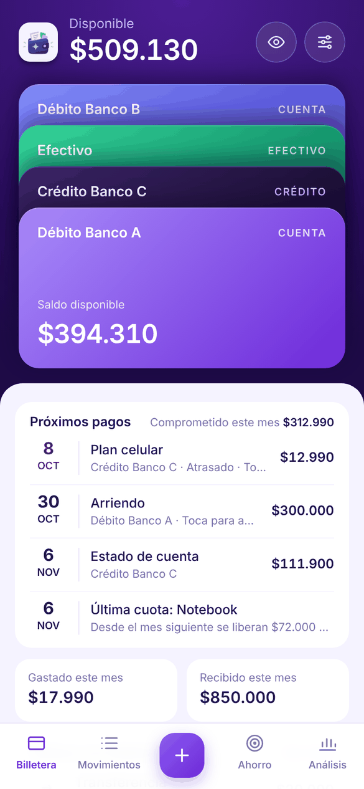
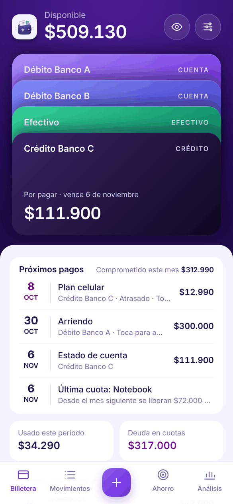
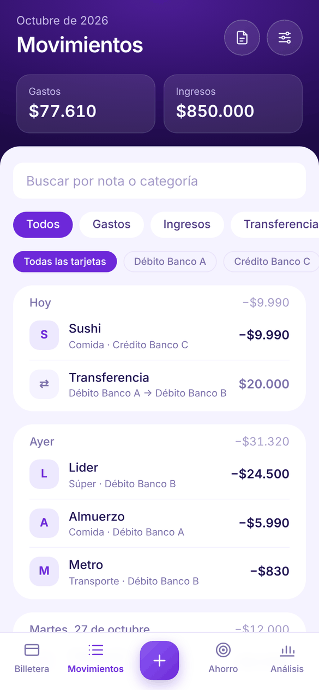
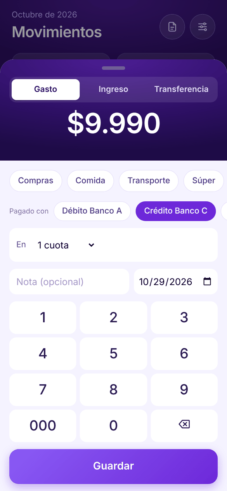
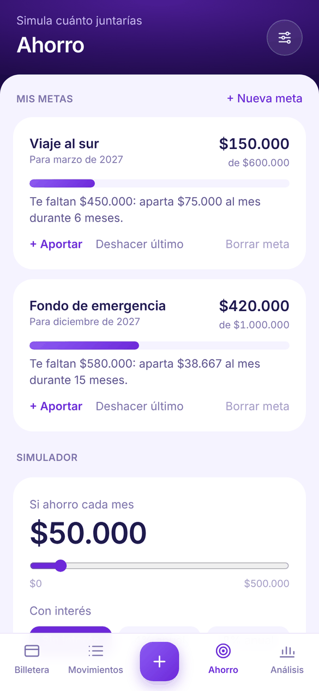
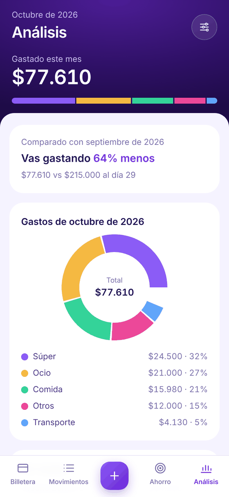

# Lumio

[](https://github.com/Isaac-Andrade970/lumio/actions/workflows/tests.yml)


**Tus gastos, en un solo lugar.** App personal de finanzas para iPhone hecha como PWA (web app instalable): registra gastos e ingresos, lleva el saldo real de cada cuenta y la deuda de la tarjeta de crédito, captura sola los pagos de Apple Pay e importa las cartolas del banco en PDF.

Es **local-first**: todos los datos viven en el teléfono (IndexedDB). No hay cuentas de usuario ni servidor con tus finanzas.

<p align="center">
  
</p>

| Billetera | Tarjeta de crédito | Movimientos |
|---|---|---|
|  |  |  |
| **Nuevo gasto** | **Ahorro y metas** | **Análisis** |
|  |  |  |

<sub>Capturas con datos de ejemplo.</sub>

## Qué hace

- **Billetera estilo Wallet**: cuentas, efectivo y tarjetas de crédito apiladas; al tocar una se ve su detalle.
- **Saldo real por cuenta**: parte del saldo que anotas y suma o resta cada movimiento, transferencia y pago de tarjeta.
- **Tarjeta de crédito**: estado de cuenta, fecha de pago, cuotas comprometidas, pagos parciales con interés estimado y saldo a favor.
- **Pagos de Apple Pay automáticos**: un Atajo de iOS manda cada pago a una bandeja en Supabase; Lumio los importa al abrirse y los borra de la nube.
- **Importar cartolas y estados de cuenta en PDF** (Banco de Chile y Banco Falabella), incluso con contraseña. Se leen en el teléfono, se verifican contra los saldos del banco y no duplican lo que ya llegó por Wallet.
- **Próximos pagos**: gastos fijos, pago de la tarjeta y cuotas que terminan, con lo comprometido del mes.
- **Metas de ahorro** con cuánto apartar al mes, y simulador con interés.
- **Aprende tus categorías**: si cambias la de un comercio, la próxima compra ahí llega con esa.
- **Modo privado** para ocultar los montos, **deslizar para borrar**, deshacer, respaldo cifrado y modo oscuro.

## Arquitectura

```
iPhone (Apple Pay) ──Atajo──▶ Supabase (bandeja, RLS + funciones con clave)
                                     │  al abrir la app
                                     ▼
PDF del banco ──pdf.js──▶  Lumio (React PWA) ◀──▶ IndexedDB (Dexie) en el teléfono
                                     │
                              Vercel (solo sirve la app)
```

- **Local-first**: Dexie sobre IndexedDB; la app funciona sin internet (service worker con Workbox).
- **Bandeja de Wallet**: tabla con RLS sin políticas; solo se accede por funciones `SECURITY DEFINER` que exigen una clave. Las filas se borran apenas llegan al teléfono (primero se guarda local, después se borra en la nube).
- **Importador de PDF**: pdf.js entrega cada texto con su posición; lectores puros (`src/lib/lectores.js`) arman las filas por columnas, unen descripciones partidas en dos líneas y verifican con los saldos y totales de control del banco antes de proponer nada.
- **Lógica separada de la interfaz**: todo el cálculo vive en `src/lib/` como funciones puras con pruebas (períodos de facturación, cuotas, saldos, importación, reglas de categorías).

## Tecnologías

React 19 · Vite · Tailwind CSS 4 · Dexie (IndexedDB) · vite-plugin-pwa · pdf.js · Recharts · Supabase · Vitest · GitHub Actions · Vercel

## Correrlo localmente

Requisitos: Node.js 22 y Git.

```bash
npm install
npm run dev
```

Abre `http://localhost:5173`. Para la captura de Apple Pay, copia `.env.example` a `.env.local` con la URL y la llave pública de tu proyecto de Supabase y corre `supabase/bandeja_wallet.sql` (cambia la clave de ejemplo antes).

| Comando | Qué hace |
|---|---|
| `npm run dev` | Servidor de desarrollo |
| `npm test` | Pruebas (Vitest) |
| `npm run build` | Versión final en `dist/` |
| `npm run preview` | Sirve la versión final |

## Estructura

```
src/
├── App.jsx                 # Pestañas, sincronización con Wallet, modo privado
├── db.js                   # Base de datos local (Dexie) y escritura de importaciones
├── components/             # Pantallas (Inicio, Movimientos, Ahorro, Análisis, Ajustes, Importar…)
└── lib/                    # Lógica pura con pruebas
    ├── credito.js          # Períodos, estado de cuenta, cuotas, saldo a favor
    ├── cuentas.js          # Saldo real por cuenta
    ├── lectores.js         # Lectura de cartolas y estados de cuenta
    ├── importar.js         # Clasificación y detección de duplicados
    ├── reglas.js           # Categorías aprendidas
    ├── agenda.js · metas.js · respaldo.js · wallet.js · bandeja.js · calculos.js
    └── *.test.js
```

## Privacidad

- Los PDF se leen en el navegador y no se guardan; solo se guardan los movimientos que eliges.
- Nada de tus finanzas pasa por Vercel ni GitHub. Supabase solo ve cada pago de Wallet unos segundos.
- Las pruebas usan únicamente datos inventados.

Cambios por versión en [CHANGELOG.md](CHANGELOG.md).
